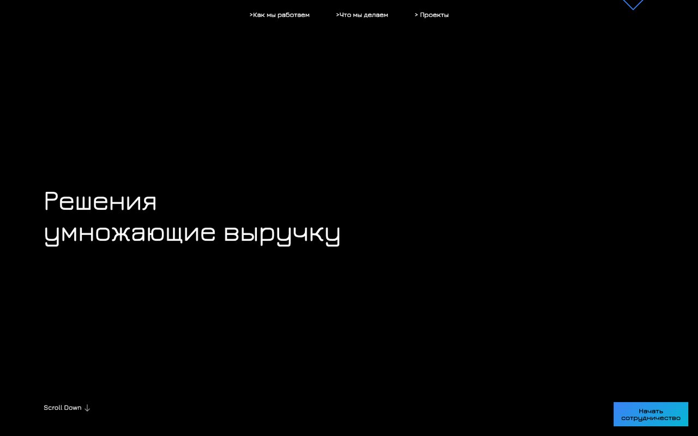
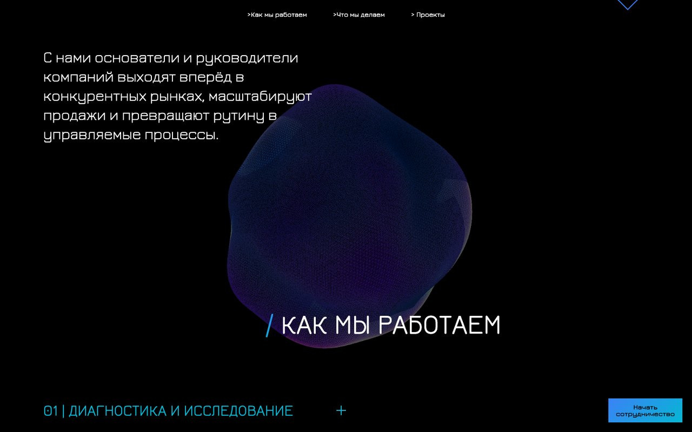
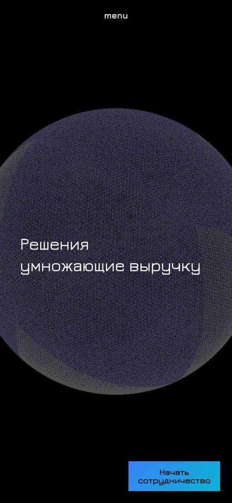
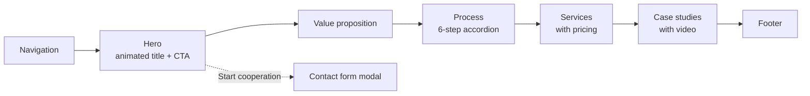
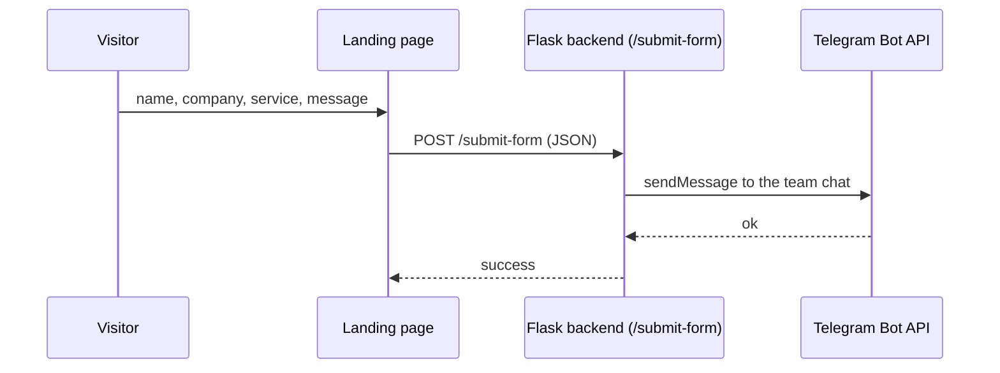

# TrueScale — AI automation studio website

The website of TrueScale, a studio that builds AI automation and digital solutions for business — "solutions that multiply revenue". A dark, technical landing page with a Three.js 3D background, a custom cursor, a six-step process, services with pricing, video case studies and a contact form that delivers requests straight to Telegram.



| How we work | Mobile |
|:---:|:---:|
|  |  |

## Page structure



Case studies: logistics service, Nikita Ben-Ami, Quest City, V5 Group — each with desktop and mobile pages.

## Contact form



## Structure

```
src/index.html           — main landing page (modular version)
src/case-studies/        — case-study pages (desktop and mobile)
src/ARCHITECTURE.md      — page architecture
src/COMPONENTS.md        — component reference
backend.py               — Flask endpoint that forwards contact-form submissions to Telegram
nginx.conf, Dockerfile   — static site container
backend.Dockerfile       — backend container
docker-compose.yml       — site + backend + Certbot
setup-ssl.sh             — Let's Encrypt certificate setup
```

## Tech stack

HTML / CSS / JavaScript (Webflow-based), Three.js, GSAP, jQuery, Flask + flask-cors, nginx, Docker, Certbot.

## Run locally

```bash
python3 -m http.server 8000 --directory src            # static site
pip install -r requirements.txt && python backend.py   # contact-form backend
```

Set the Telegram bot token and chat ID in `backend.py` (preferably through environment variables) before running the backend.

## Deploy

```bash
docker compose up -d --build
./setup-ssl.sh
```
